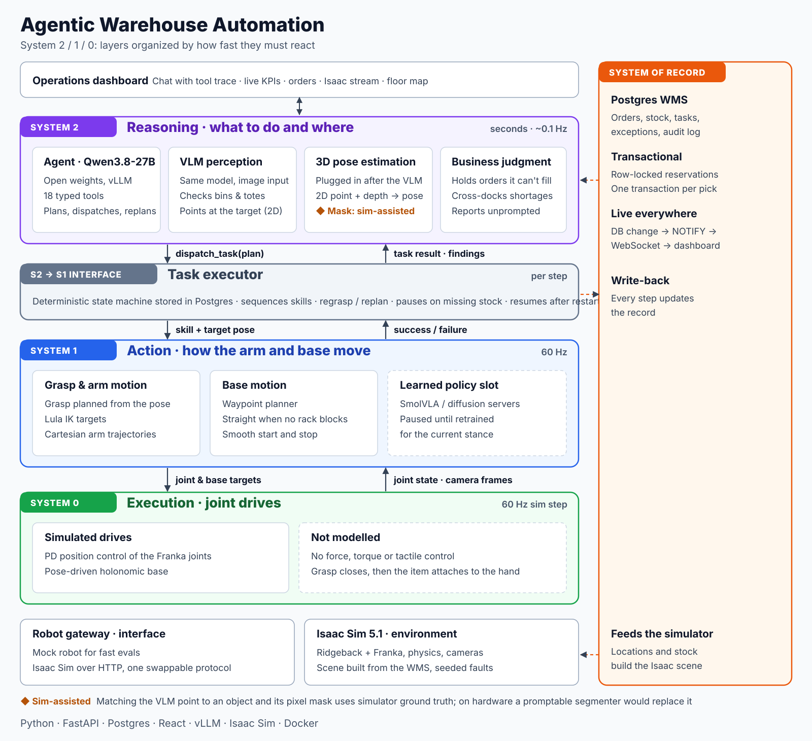

<p align="center">
  <h1 align="center">Agentic Warehouse Automation</h1>
  <p align="center">
    <strong>A VLM agent that runs warehouse workflows end to end: it plans, perceives, and directs a simulated mobile manipulator for the physical work</strong>
  </p>
  <p align="center">
    <a href="https://github.com/Michae1Park/agentic-warehouse-automation/actions/workflows/ci.yml"></a>
    <a href="https://www.python.org/downloads/"></a>
    <a href="https://docs.isaacsim.omniverse.nvidia.com/"></a>
  </p>
</p>

---

<p align="center">
  <b>Author:</b> <a href="https://michae1park.github.io">Michael Park</a>
</p>

---

## Overview

A warehouse manager types *"Prepare order #1045 and move it to dispatch."* The agent reads the order from the warehouse database, reserves stock, plans the route and sends a mobile manipulator to pick it. The same model, used as a vision-language model, checks each shelf bin and audits the outbound tote before the order closes. Every physical step writes back to the database, so the chat, dashboard and live simulation always agree.

<p align="center"><br><b>End-of-Shift Dispatch</b><br><sub>24 tool calls: prioritizes 5 orders, cross-docks, re-plans mid-run, puts away surplus</sub><br></p>

https://github.com/user-attachments/assets/d01bfdef-6a93-4b17-9280-ef22a0ac03ff

<p align="center"><br><b>Cycle Count</b><br><sub>VLM finds misplaced stock, robot moves it back to its home bin</sub><br></p>

https://github.com/user-attachments/assets/db60bb85-688e-43e2-a352-2f2f45b420d8

<br>

### What It Does

| Workflow | Input | Execution & output |
|---|---|---|
| **End-of-shift dispatch** | *"Get all pending DISPATCH-1 orders out before the truck leaves"* | • Plans 5 orders by priority, holds what it can't fill and flags it<br>• Cross-docks a shortage from the receiving tote<br>• Re-plans when a bin turns out empty mid-run, then puts away the surplus |
| **Order fulfillment** | *"Prepare order #1045"* | • Reserves stock across bins, plans the route, picks into the robot's tote<br>• Unloads into the outbound tote on the conveyor<br>• VLM audits the tote, then the order closes |
| **Cycle count** | *"Cycle count aisle B"* | • VLM checks each bin against the WMS record<br>• Writes `cycle_count` adjustments, raises discrepancies, moves misplaced stock back to its home bin |
| **Shortage recovery** | *"Prepare order #1044"* (short on the shelf) | • Finds the gap covered by the receiving tote<br>• Cross-docks: picks the shelf stock and the received units in one trip<br>• Puts away only the surplus |
| **Exception handling** | Failed pick, blocked path, missing stock | • Executor retries the pick and replans the path<br>• Missing stock pauses the task; the agent reallocates or escalates |

<details>
<summary><b>Execution trace (end-of-shift dispatch)</b></summary>

**Request:** *"Get all pending DISPATCH-1 orders out before the truck leaves."* (24 tool calls over 6 turns)

| Step | What happens |
|---|---|
| **1. Survey** | • `list_orders`, `get_order` ×5, `find_stock`<br>• 5 orders: #1042 and #1045 (P1), #1044 and #1046 (P2), #1040 (P3) |
| **2. Prioritize** | • P1 first: #1042 and #1045 take the shelf mustard and all the soup<br>• #1044 (3× mustard) is short on the shelf, so it is cross-docked from receiving<br>• #1040 is left short of soup: held and flagged with `report_exception`<br>• #1046 (crackers) is non-pickable: flagged for manual handling, never dispatched |
| **3. Dispatch** | `plan_fulfillment` → `dispatch_task` per order, in priority order |
| **4. Mid-run surprise** | • B-01-1 turns out empty: the executor records 0 and pauses #1044<br>• Agent calls `reallocate_pick` to take the missing unit from receiving, and the task resumes |
| **5. Surplus** | • Receiving holds 1 unreserved mustard after the change<br>• Agent plans `replenish_stock` and dispatches the put-away |
| **6. Report** | 3 orders shipped, 2 flagged with reasons, receiving empty |

</details>

<details>
<summary><b>Results</b> (longer-horizon stress test, fulfillment, perception, grounding, tote audit)</summary>

### Longer-horizon stress test

A held-out test of the agent alone: randomized shifts it was never tuned on, mock robot, scored from the physical truth and the final database state (`eval/agent_eval.py --scenarios stress stress_xl`).

**Baseline (2026-11-27):** the agent as-is, before any long-horizon improvements. Later versions are compared against these numbers.

| Tier | Orders | Baseline pass, with recipes | Baseline pass, without | Tool calls (mean, range) |
|---|---|---|---|---|
| `stress` | 12 + 2 other-dock | **2 / 10** | 0 / 10 | 43 (34–59) |
| `stress_xl` | 20 + 3 other-dock | 0 / 10 | 0 / 10 | 61 (21–89) |

<details>
<summary>Test parameters and per-check results</summary>

| Parameter | `stress` | `stress_xl` |
|---|---|---|
| Orders to dispatch | 12, priority 1–3, 1–2 lines of 1–3 units | 20 |
| Orders for another dock (must be left alone) | 2 | 3 |
| Orders needing a non-pickable SKU (manual only) | 2 | 3 |
| Stock records pointing at an empty bin (found mid-run) | 3 | 5 |
| Shelf stock per SKU | 2–3 bins × 1–3 units | 3–4 bins × 2–4 units |
| Receiving stock per SKU | 0–4 units | 0–4 units |
| Seeds × trials | 10 random seeds, temperature 0.7, one request: *"dispatch everything you can before end of shift"* | same |

| Dimension | Check | `stress` with · without | `stress_xl` with · without |
|---|---|---|---|
| Dependent decisions | Priority respected, no fillable order left behind | 3/10 · 5/10 | **0/10 · 0/10** |
| Dependent decisions | Manual orders not dispatched, and flagged | 7/10 · 8/10 | 10/10 · 9/10 |
| Dependent decisions | Other dock untouched | 10/10 · 10/10 | 10/10 · 10/10 |
| Surprises / replanning | No task left paused | 10/10 · 10/10 | 9/10 · 4/10 |
| Step count / follow-through | Every unfilled order flagged | 10/10 · 8/10 | 7/10 · 3/10 |
| Step count / follow-through | Cross-dock leftovers put away | 6/10 · 1/10 | 5/10 · 7/10 |

- The agent follows simple rules and sustains 50–90 tool calls, but cannot keep a 12–20-order allocation consistent after a surprise: it fills lower-priority orders with stock a higher-priority one needed
- Without recipes it often stops after a few turns, leaving tasks paused and orders unflagged
- The multi-step scenarios in the table below are the dev set the recipes were written against; this stress test is the held-out number
- Traces for every trial: `eval/results/agent_stress/traces/`

</details>

### All tests

Simulation only, compared against a scripted baseline.

| Test | Result | Baseline | Speed | Setup |
|---|---|---|---|---|
| **Robustness under faults** | • **100%** orders filled<br>• **87%** inventory accuracy | Without recovery: 50% filled, 81% accuracy | 84s / order | • 24 single-order requests, mock robot<br>• 15–20% fault rates |
| **Shelf-bin perception** | • **100%** presence<br>• **92–96%** exact count<br>• **36 / 36** bad records caught | — | 1.5s / bin | 72 bins |
| **Language grounding** | **94%** correct item | — | 1.2s / query | 306 queries |
| **Tote audit** | • **6 / 6** exact<br>• **2 / 2** mis-packs caught | — | 1.4s / tote | 8 totes |
| **Multi-step planning (dev set)** | • **16 / 20** multi-step scenarios solved end to end<br>• End-of-shift: **4 / 5** at ~25 tool calls (up to 28), with a mid-run re-plan | • Without recipes: 9 / 20<br>• End-of-shift: 0 / 5 | — | • 4 scenarios × 5 trials<br>• Temperature 0.7 |

<details>
<summary>Details</summary>

| Test | Notes |
|---|---|
| **Robustness** | • `eval/run_eval.py`: 24 orders across 3 randomized setups, each sent as its own request<br>• Faults: 15% of picks fail, 10% of drives are blocked, 20% of stock records point at an empty bin<br>• Measures the full system: the executor retries picks and replans paths, the agent decides on missing stock<br>• Accuracy stays below 100% because empty bins the robot never visits go undiscovered<br>• 84s / order (sim time) vs ~27s without faults: tasks wait while the agent decides |
| **Perception** | • `eval/vlm_eval.py`: 72 bins across 3 randomized setups; 36 seeded with a wrong record |
| **Grounding** | • `eval/grounding_eval.py`: by name, description or attribute (*"the red can"*)<br>• 96% on the two pickable products |
| **Tote audit** | 6 packed orders + 2 mis-packed totes at the conveyor |
| **Long-horizon** | • `eval/agent_eval.py`, mock robot: only the agent's plan and its execution are scored, from the final database state<br>• Scenarios: 6-order batch, open-ended aisle triage, competing orders, end-of-shift (5 orders, cross-dock, mid-run missing stock, surplus put-away)<br>• Per scenario, with / without recipes: batch 5/5 · 5/5, competing 5/5 · 4/5, end-of-shift 4/5 · 0/5, triage 2/5 · 0/5<br>• Failures are judgment, not crashes: skipped follow-up, refilling a just-corrected bin, one 42-call lookup loop |

</details>

</details>

<details>
<summary><b>Limitations</b></summary>

| Area | What is simplified |
|---|---|
| **Grasping** | • Scripted Lula IK from a depth pose estimate; the item attaches once the fingers close<br>• SmolVLA / diffusion policies in `vla/` are paused until retrained for the current stance |
| **System 0** | • Minimal: simulated joint drives only<br>• No force, torque, contact or slip control |
| **Products** | • 2 robot-pickable products (mustard, tomato soup)<br>• The other 10 SKUs are flagged non-pickable and routed to manual handling |
| **Navigation** | • Simulator waypoint planner: straight when clear, aisle center lines otherwise<br>• No ROS 2 / Nav2 / MoveIt 2; `RobotGateway` is where they would plug in |
| **Perception** | • One fixed inspection camera per location<br>• Cycle counts trust presence, not quantities: unseen SKU → 0, unrecorded SKU → flagged |
| **◆ Sim-assisted perception** | • The VLM outputs a 2D point on the item<br>• 3D pose estimation is sim-assisted: the point is matched to an item and its outline using simulator ground truth, then fitted to depth. A real robot would get the outline from a segmentation model such as SAM, prompted with the VLM's point<br>• Items in the robot's own tote use the simulator pose directly |
| **Faults** | Injected at random (reproducibly) into the simulator, not the database |
| **Conveyor** | Moves totes kinematically out through the wall; no packing or shipping behind it |

</details>

---

## Architecture

<p align="center">
  
</p>

### Architectural Invariants

| Invariant | What it means |
|---|---|
| **One system of record** | • Postgres holds orders, inventory, tasks and exceptions<br>• `LISTEN/NOTIFY` streams every change to the UI, so chat, dashboard and sim never disagree |
| **Typed tools, no free-form SQL** | • The agent acts only through tools that wrap transactions (`plan_fulfillment`, `dispatch_task`, …)<br>• Reservations use `SELECT … FOR UPDATE`, so two plans cannot promise the same unit<br>• Each pick updates stock, the order line and an audit row in one transaction |
| **Simulator separate from the database** | • Faults change the simulator, not the database<br>• The WMS can actually be wrong, so inventory accuracy means something |
| **Models do what they are good at** | • The VLM says *what and where* (a 2D point, a scene description), never a pose<br>• A 3D pose estimation module turns the point into a pose from depth; motion is scripted IK<br>• ◆ The point-to-object step is sim-assisted (see Limitations) |

<details>
<summary><b>System layers: what each part does</b></summary>

Layers are organized by how fast they must react (System 2 / 1 / 0).

| Layer | Rate | Part | What it does |
|---|---|---|---|
| **System 2** (reasoning) | seconds | **Agent** | • Tool-calling loop on Qwen3.8-27B (FP8, vLLM)<br>• Picks the workflow, plans, dispatches, replans on results |
| | | **VLM perception** | • Same model with image input<br>• Bin checks, grounding the described item, tote audit |
| | | **3D pose estimation** | • Plugged in after the VLM, which only outputs a 2D point<br>• ◆ Sim-assisted: the item and its outline come from simulator ground truth, then a depth fit gives position, yaw and height |
| **S2 → S1 interface** | per step | **Task executor** | • Deterministic state machine stored in Postgres<br>• Sequences skills, retries (failed pick, blocked path), pauses on missing stock, resumes after restart<br>• Reports results and findings back up |
| **System 1** (action) | 60 Hz | **Grasp & arm motion** | • Grasp planned from the estimated pose<br>• Lula IK targets, Cartesian arm trajectories |
| | | **Base motion** | • Waypoint planner, straight when no rack blocks<br>• Smooth start and stop |
| | | **Learned policy slot** | • SmolVLA and diffusion policy servers<br>• Paused until retrained for the current stance |
| **System 0** (execution) | 60 Hz in sim<br>~1 kHz on a real robot | **Simulated drives** | • PD position control of the Franka joints<br>• Pose-driven holonomic base<br>• No force, torque or tactile control |
| **Outside the layers** | — | **Postgres WMS** | • System of record: orders, stock, tasks, exceptions<br>• Every step writes back; changes stream to the dashboard |
| | | **Robot gateway** | • One interface: mock robot for evals, Isaac Sim over HTTP |
| | | **Isaac Sim 5.1** | • The environment: Ridgeback + Franka, physics, cameras<br>• Scene built from the WMS, seeded faults |
| | | **Dashboard** | • React + Vite: agent chat with tool trace, live sim stream, 2D floor map, orders and exceptions |

</details>

<details>
<summary><b>Design choices</b></summary>

| Choice | Why |
|---|---|
| **One model for reasoning and vision** | • Qwen3.8-27B (FP8, vLLM): open weights, native tool calling, image input<br>• The same model runs the agent and checks bins and totes |
| **No agent framework** | • One agent with typed tools, a persistent task state machine and deterministic recovery<br>• Proved more reliable than agents passing messages |
| **The VLM never outputs poses** | • It names the item and points at it (2D)<br>• A 3D pose estimation module turns that point into a pose from depth; IK plans the grasp |

</details>

<details>
<summary><b>Failure handling</b></summary>

| Fault | Handled by | Recovery | Escalation |
|---|---|---|---|
| **Failed pick** | Executor | Retry the pick, up to 3 attempts | • Task fails, reservations released<br>• Exception raised, agent reports |
| **Blocked path** | Executor | Replan the path, up to 3 attempts | Same |
| **Ordered SKU not seen at a bin** | Executor → agent | • Executor counts that SKU at the bin to 0, pauses the task, reports up<br>• Agent decides: `reallocate_pick` from other bins or receiving, then resumes | • Nothing covers it: agent cancels and escalates<br>• No agent (scripted mode): executor reallocates itself |
| **Item blocking the target** | Executor → agent | • Task pauses<br>• Agent calls `clear_blocker`, then resumes the task | Push demo paused (see the tools table) |
| **Shortage at planning** | Agent | • Receiving covers it: cross-dock in one trip<br>• Put away the surplus | Otherwise: no dispatch, exception and options |
| **Misplaced stock found by a count** | Agent | Moves it back to its home bin | — |

When a task finishes, the executor posts a `[SYSTEM EVENT]` to the conversation that created it, and the agent reports back unprompted.

</details>

<details>
<summary><b>Agent tools: the 18 typed tools the agent can call</b></summary>

| Group | Tool | What it does |
|---|---|---|
| **Orders** | `list_orders` | List orders, optionally by status |
| | `get_order` | Order with its lines (SKU, quantity, picked) |
| | `plan_fulfillment` | • Reserve stock and create a pick task with an optimized route<br>• Can also pick from the receiving tote (cross-dock)<br>• Fails with a reason when short |
| **Inventory** | `find_stock` | Every location holding a SKU or product name, with available quantity (shelves and receiving) |
| | `get_location` | Contents of a location |
| | `find_empty_bins` | Empty storage bins, optionally in one aisle |
| | `inspect_inventory` | Plan a VLM cycle count over bins or an aisle; corrects the records |
| | `relocate_stock` | Plan a move of stock between storage bins |
| | `replenish_stock` | Plan a put-away of received stock from the receiving tote to a bin |
| **Robot & tasks** | `get_robot_status` | Robot status, position, battery and tote contents |
| | `dispatch_task` | Send a planned task to the robot (asynchronous) |
| | `get_task_status` | Task status and per-step progress |
| | `wait_for_task` | Block until a task finishes, when the next step depends on it |
| | `clear_blocker` | • Splice `take_tool paddle → push_blocker → return_tool` before a blocked pick<br>• Paused: the push policy and paddle are not in the current demo scene |
| | `reallocate_pick` | • For a task paused on missing stock<br>• Reserves the gap from other bins (optionally receiving) and splices in new picks |
| | `cancel_task` | Cancel a planned or queued task and release its reservations |
| **Exceptions** | `list_exceptions` | List open, resolved or escalated exceptions |
| | `report_exception` | Record an exception that needs human attention |

</details>

---

## Quickstart

**Prerequisites:** Linux, an NVIDIA GPU, Docker with the NVIDIA runtime, and the Qwen3.8-27B-FP8 weights in the Hugging Face cache.

### 1. Configure

```bash
git clone https://github.com/Michae1Park/agentic-warehouse-automation.git && cd agentic-warehouse-automation
cp .env.example .env                        # ROBOT_BACKEND=mock for fast mode
```

### 2. Run the Isaac demo

```bash
scripts/demo.sh                             # high graphics, WebRTC, CPU-pinned, GPU budget check
```

`demo.sh` checks free GPU memory before starting:
- Budgets Isaac Sim, the LLM (`LLM_GPU_UTIL`, default 0.75) and, with a learned policy, the VLA server
- Refuses to start if other GPU jobs leave too little
- For a smaller GPU, use the lighter model commented in `.env.example`

### 3. Or run without the simulator

```bash
docker compose up -d                        # postgres, vLLM, backend, dashboard on http://localhost:5173
```

### 4. Evaluate

```bash
python3 eval/run_eval.py --seeds 1 2 3 --orders 8    # fulfillment KPIs, mock robot
python3 eval/vlm_eval.py                             # bin perception, needs the isaac profile
```

<details>
<summary><b>Once open: what you can do</b></summary>

| Area | What you can do |
|---|---|
| **Chat** | • *"Get all pending DISPATCH-1 orders out before the truck leaves"*<br>• *"Prepare order #1045"*<br>• *"Cycle count aisle B"*<br>• Every turn shows the tool trace |
| **Isaac view** | • Drag to orbit, right/shift-drag to pan, scroll to zoom<br>• Double-click or **reset view** to return to the overview |
| **Teleop** | `scripts/teleop.sh` opens a browser controller on :8020 for push demos and VLA intervention |

</details>

<details>
<summary><b>Isaac mode without <code>demo.sh</code>, and repository layout</b></summary>

```bash
echo -e "ROBOT_BACKEND=isaac\nSIM_URL=http://localhost:8020" >> .env
docker compose --profile isaac up -d        # add ISAAC_ARGS="--livestream --graphics high" for WebRTC
```

WebRTC livestream ports:
- TCP 49100 (signaling)
- UDP 47998 (media)

```
db/            schema, triggers, views and seed data
backend/app/   FastAPI: agent/, executor.py, warehouse.py, perception.py, robot/{mock,isaac}.py, sim/world.py
isaac/         Isaac Sim warehouse server (scene, robot control, conveyor, cameras, MJPEG stream)
vla/           SmolVLA and diffusion dataset conversion, training and policy server
frontend/      React dashboard
eval/          fulfillment, perception and grounding benchmarks
scripts/       demo and teleop launchers
```

</details>
